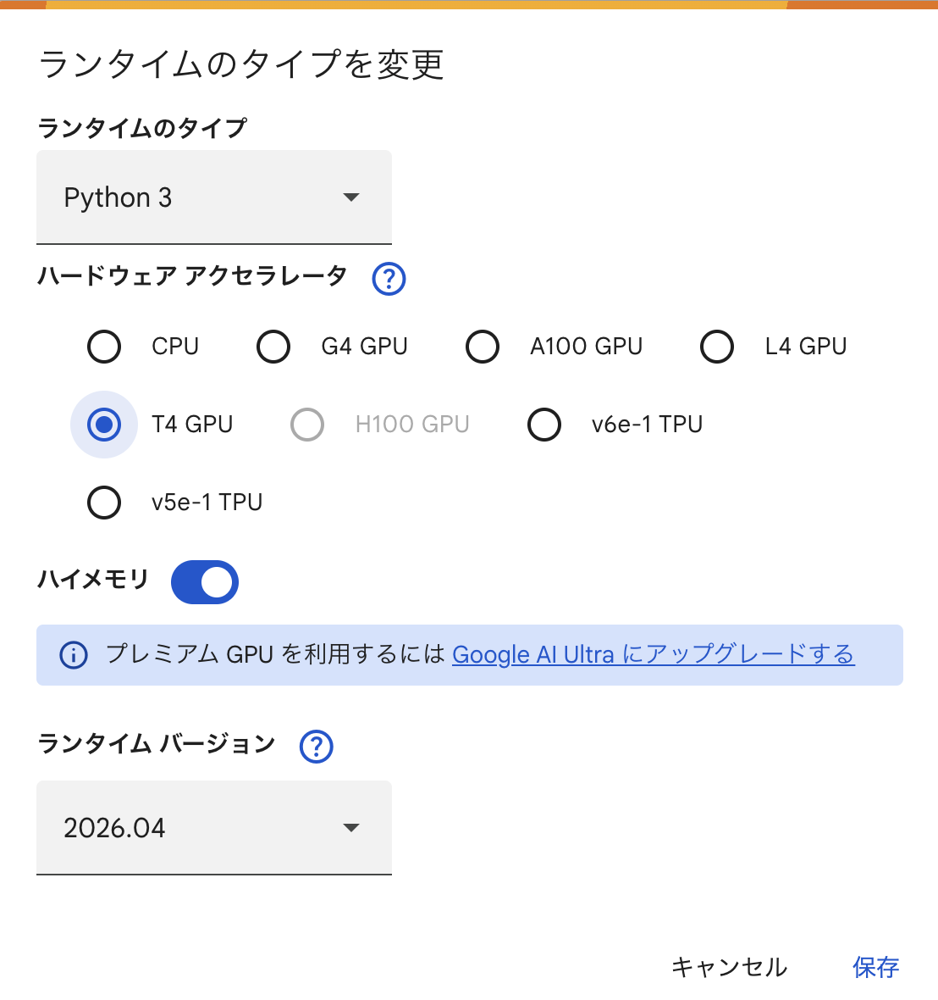

# LLM: The Hard Parts

---


---

本リポジトリはオライリー・ジャパン発行書籍『[LLM: The Hard Parts](https://www.amazon.co.jp/dp/4814401930/)』のサポートサイトです。

## 構成

```
.
├── files                         # 関連ファイル（参考）
└── notebooks
　　　├── ch02                     # 2章のコード（ノートブック形式）
　　　│　 └── ch02.ipynb
　　　├── ch03                     # 3章のコード（ノートブック形式）
　　　│　 ├── ch03-1.ipynb
　　　│　 ├── ch03-2.ipynb
　　　│　 ├── ch03-3.ipynb
　　　│　 └── ch03-4.ipynb
　　　├── ch04                     # ...
　　　│　 ├── ch04-1.ipynb
　　　│　 ├── ch04-2.ipynb
　　　│　 └── ch04-3.ipynb
　　　├── ch05
　　　│　 ├── ch05-1.ipynb
　　　│　 ├── ch05-2.ipynb
　　　│　 └── ch05-3.ipynb
　　　├── ch07
　　　│　 ├── ch07-1.ipynb
　　　│　 ├── ch07-2.ipynb
　　　│　 ├── ch07-3.ipynb
　　　│　 ├── ch07-4.ipynb
　　　│　 ├── ch07-5.ipynb
　　　│　 ├── ch07-6.ipynb
　　　│　 ├── ch07-7.ipynb
　　　│　 ├── ch07-8.ipynb
　　　│　 └── ch07-9.ipynb
　　　└── ch08
　　　　　├── ch08-1.ipynb
　　　　　└── ch08-2.ipynb
```

サンプルコードの解説は本書籍をご覧ください。

## Google Colabで開く

|章    |ノートブック |
|---             |---          |
|2章　           |評価ギャップ |
| `ch02.ipynb`   |[](https://colab.research.google.com/github/oreilly-japan/llms-thp-ja/blob/main/notebooks/ch02/ch02.ipynb)   |
|3章　           |LLMベースアプリケーション向け評価ツール |
| `ch03-1.ipynb` |[](https://colab.research.google.com/github/oreilly-japan/llms-thp-ja/blob/main/notebooks/ch03/ch03-1.ipynb) |
| `ch03-2.ipynb` |[](https://colab.research.google.com/github/oreilly-japan/llms-thp-ja/blob/main/notebooks/ch03/ch03-2.ipynb) |
| `ch03-3.ipynb` |[](https://colab.research.google.com/github/oreilly-japan/llms-thp-ja/blob/main/notebooks/ch03/ch03-3.ipynb) |
| `ch03-4.ipynb` |[](https://colab.research.google.com/github/oreilly-japan/llms-thp-ja/blob/main/notebooks/ch03/ch03-4.ipynb) |
|4章　           |データからコンテキストへ |
| `ch04-1.ipynb` |[](https://colab.research.google.com/github/oreilly-japan/llms-thp-ja/blob/main/notebooks/ch04/ch04-1.ipynb) |
| `ch04-2.ipynb` |[](https://colab.research.google.com/github/oreilly-japan/llms-thp-ja/blob/main/notebooks/ch04/ch04-2.ipynb) |
| `ch04-3.ipynb` |[](https://colab.research.google.com/github/oreilly-japan/llms-thp-ja/blob/main/notebooks/ch04/ch04-3.ipynb) |
|5章　           |構造化データの出力 |
| `ch05-1.ipynb` |[](https://colab.research.google.com/github/oreilly-japan/llms-thp-ja/blob/main/notebooks/ch05/ch05-1.ipynb) |
| `ch05-2.ipynb` |[](https://colab.research.google.com/github/oreilly-japan/llms-thp-ja/blob/main/notebooks/ch05/ch05-2.ipynb) |
| `ch05-3.ipynb` |[](https://colab.research.google.com/github/oreilly-japan/llms-thp-ja/blob/main/notebooks/ch05/ch05-3.ipynb) |
|7章　           |LLMの安全性評価 |
| `ch07-1.ipynb` |[](https://colab.research.google.com/github/oreilly-japan/llms-thp-ja/blob/main/notebooks/ch07/ch07-1.ipynb) |
| `ch07-2.ipynb` |[](https://colab.research.google.com/github/oreilly-japan/llms-thp-ja/blob/main/notebooks/ch07/ch07-2.ipynb) |
| `ch07-3.ipynb` |[](https://colab.research.google.com/github/oreilly-japan/llms-thp-ja/blob/main/notebooks/ch07/ch07-3.ipynb) |
| `ch07-4.ipynb` |[](https://colab.research.google.com/github/oreilly-japan/llms-thp-ja/blob/main/notebooks/ch07/ch07-4.ipynb) |
| `ch07-5.ipynb` |[](https://colab.research.google.com/github/oreilly-japan/llms-thp-ja/blob/main/notebooks/ch07/ch07-5.ipynb) |
| `ch07-6.ipynb` |[](https://colab.research.google.com/github/oreilly-japan/llms-thp-ja/blob/main/notebooks/ch07/ch07-6.ipynb) |
| `ch07-7.ipynb` |[](https://colab.research.google.com/github/oreilly-japan/llms-thp-ja/blob/main/notebooks/ch07/ch07-7.ipynb) |
| `ch07-8.ipynb` |[](https://colab.research.google.com/github/oreilly-japan/llms-thp-ja/blob/main/notebooks/ch07/ch07-8.ipynb) |
| `ch07-9.ipynb` |[](https://colab.research.google.com/github/oreilly-japan/llms-thp-ja/blob/main/notebooks/ch07/ch07-9.ipynb) |
|8章　           |LLMアラインメント：ケーススタディ |
| `ch08-1.ipynb` |[](https://colab.research.google.com/github/oreilly-japan/llms-thp-ja/blob/main/notebooks/ch08/ch08-1.ipynb) |
| `ch08-2.ipynb` |[](https://colab.research.google.com/github/oreilly-japan/llms-thp-ja/blob/main/notebooks/ch08/ch08-2.ipynb) |

> [!NOTE]
> 
> Google Colabのランタイムバージョンは、Colabのメニューから `ランタイムタイプを変更` を選択すると変更可能です。
> 次のように `2026.04` が選択されていれば、日本語版の翻訳時点に比較的近い環境でコードを実行可能です。
> 
> 


----

## 正誤表

本書の正誤情報は以下のページで公開しています。

<https://github.com/oreilly-japan/llms-thp-ja/wiki/errata>

本ページに掲載されていない誤植など間違いを見つけた方は、[japan@oreilly.co.jp](<mailto:japan@oreilly.co.jp>)までお知らせください。
